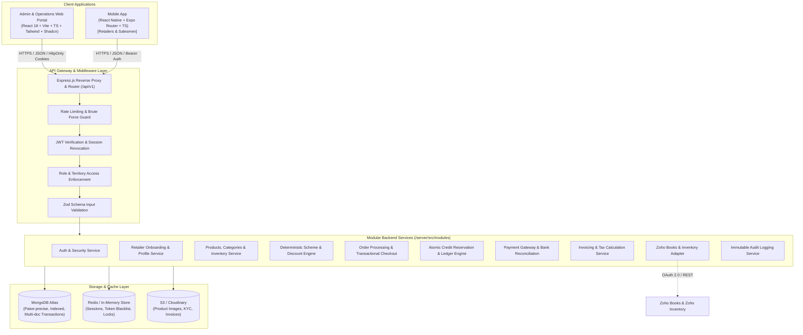

# NECESSITY INDIA PVT. LTD. — PLATFORM ARCHITECTURE SPECIFICATION
## Enterprise B2B Distributor, Retailer Ordering, Credit & Payment Management Platform

---

### 1. Architectural Overview & System Context

**Necessity India Pvt. Ltd.** operates as a large-scale distributor of household, commercial, and hospitality supplies (including napkins, towels, cleaning consumables, tray covers, and institution packs). 

The platform connects three primary user classes and internal business roles:
1. **Retailers & Institutional Buyers**: Self-service ordering, credit limit visibility, invoice downloads, automated discount schemes, and multi-mode payment settlements.
2. **Field Sales Force (Salesmen & Territory Managers)**: Field order booking on behalf of retailers, visit logs, payment collection logging, territory performance tracking.
3. **Internal Operations (Admins, Accounts, Warehouse, Dispatch)**: Customer onboarding and credit limit approval, order processing, warehouse fulfillment, invoice issuance, bank transfer reconciliation, discount scheme configuration, and Zoho accounting synchronization.



---

### 2. Monorepo Structure

The codebase is organized as a unified, high-cohesion monorepo:

```
necessity-b2b/
├── apps/
│   ├── admin-web/               # Desktop-first Admin, Accounts, Warehouse Web Portal
│   │   ├── src/
│   │   │   ├── components/      # UI components (Button, Input, Table, Modal, Card, etc.)
│   │   │   ├── features/        # Feature domains (auth, retailers, orders, credit, payments, schemes)
│   │   │   ├── hooks/           # Reusable hooks (useAuth, useDebounce, useCurrency)
│   │   │   ├── lib/             # API client (Axios/Ky + TanStack Query), utils
│   │   │   ├── routes/          # Protected & public route definitions
│   │   │   └── types/           # Web-specific presentation types
│   │   ├── index.html
│   │   ├── vite.config.ts
│   │   └── package.json
│   │
│   └── mobile/                  # Retailer & Salesman Universal Mobile App
│       ├── app/                 # Expo Router file-based screens
│       │   ├── (auth)/          # Login, Register, Forgot Password
│       │   ├── (retailer)/      # Dashboard, Catalogue, Cart, Orders, Ledger, Payments
│       │   └── (salesman)/      # Beat Schedule, Assigned Retailers, Order Booking
│       ├── components/          # Native UI widgets
│       ├── lib/                 # SecureStore session manager, API client
│       └── package.json
│
├── server/                      # High-security Node.js + Express + TypeScript Backend
│   ├── src/
│   │   ├── config/              # Environment config, DB, Redis, Logger
│   │   ├── constants/           # Error codes, HTTP status, currency rules
│   │   ├── middleware/          # auth, rbac, errorHandler, rateLimit, requestLogger
│   │   ├── modules/             # High-cohesion domain modules:
│   │   │   ├── auth/            # Registration, login, token rotation, sessions
│   │   │   ├── users/           # User management, profile, status
│   │   │   ├── retailers/       # Retailer profile, KYC, GSTIN, credit limits
│   │   │   ├── salesmen/        # Salesmen profiles, assigned territories
│   │   │   ├── territories/     # Geofenced/named territories
│   │   │   ├── products/        # SKUs, pack sizes, tax codes (HSN/SAC)
│   │   │   ├── categories/      # Category taxonomy
│   │   │   ├── inventory/       # Stock tracking, warehouse management
│   │   │   ├── schemes/         # Promotional rules, slab discounts, free units
│   │   │   ├── carts/           # Server-side cart recalculations
│   │   │   ├── orders/          # Multi-document transactional checkout
│   │   │   ├── invoices/        # Tax invoices, HSN summaries, GST splits
│   │   │   ├── credit/          # Available credit calculator & reservations
│   │   │   ├── ledger/          # Double-entry compliant financial ledger
│   │   │   ├── payments/        # UPI, Bank Transfer (UTR), Gateway sessions
│   │   │   ├── integrations/    # Zoho Books/Inventory, Cloudinary, SMS
│   │   │   └── audit/           # Immutable compliance audit trails
│   │   ├── app.ts               # Express application initialization & middleware
│   │   └── server.ts            # Process lifecycle & graceful shutdown
│   ├── tsconfig.json
│   └── package.json
│
├── packages/
│   └── shared/                  # Zero-dependency shared types & validation schemas
│       ├── src/
│       │   ├── enums/           # Roles, OrderStatus, PaymentStatus, LedgerEntryType
│       │   ├── schemas/         # Zod schemas (Auth, Retailer, Order, Payment)
│       │   ├── types/           # TypeScript interfaces for API contracts
│       │   └── utils/           # Currency formatting (paise to INR), calculation math
│       ├── tsconfig.json
│       └── package.json
│
├── docs/                        # Architecture, checklists, schemas, external config
├── scripts/                     # Seeding, database migrations, backup tools
├── pnpm-workspace.yaml          # Monorepo workspace configuration
├── .npmrc                       # Hoisted node_modules configuration
└── package.json                 # Monorepo root scripts
```

---

### 3. Financial Exactitude & Core Principles

1. **Integer Currency Representation**: All monetary values (MRP, wholesale prices, line totals, taxes, discounts, credit limits, ledger entries) are stored as **exact integers in paise** (1 INR = 100 paise). Floating point arithmetic is strictly forbidden.
2. **Server-Authoritative Computations**: Clients may propose items and quantities; the server authoritatively recalculates unit prices, applicable schemes, GST rates (CGST/SGST/IGST), order totals, and credit limits.
3. **Atomic Multi-Document Operations**: All state changes involving stock decrement and credit reservation occur in MongoDB transactions with idempotency tokens.
4. **Immutable Financial History**: Historical order lines and invoices store an exact snapshot of product details, prices, HSN codes, and discounts at the timestamp of issuance.
5. **No Blind Trust in External Webhooks**: All payment callbacks and Zoho sync hooks are verified using cryptographic signatures (HMAC SHA-256) and verified against provider APIs before ledger updates.
