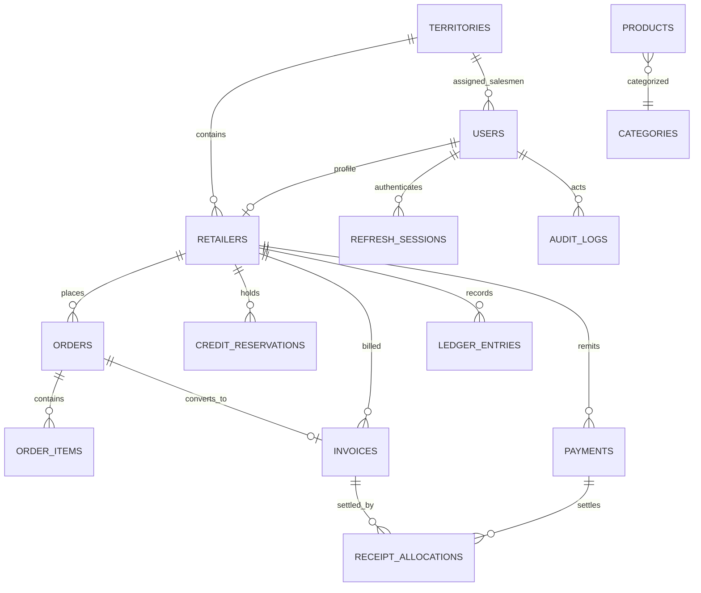

# DATABASE SCHEMAS AND STATE TRANSITIONS
## Necessity India Pvt. Ltd. — Persistence Specification

---

### 1. Financial Precision & Core Data Types

1. **Currency**: All amounts (product prices, taxes, discounts, delivery fees, order totals, credit limits, receivables, payment amounts, ledger postings) MUST be stored as **64-bit integer paise** (1 INR = 100 paise).
   - Example: ₹1,500.75 is stored as `150075`.
   - Never use JavaScript `Number` floating point arithmetic for cumulative balances.
2. **Timestamps**: All timestamps are UTC `Date` objects generated server-side.
3. **Identifiers**: MongoDB `ObjectId` with indexing on foreign keys; unique human-readable business numbers for Orders (`ORD-2026-XXXXX`), Invoices (`INV-2026-XXXXX`), and Payments (`PAY-2026-XXXXX`).

---

### 2. Core Collections & Schema Definitions



#### 2.1 Collection: `users`
- `_id`: ObjectId
- `email`: String (lowercase, trimmed, unique, sparse)
- `phone`: String (E.164 format, e.g., `+919876543210`, unique, required)
- `name`: String (required)
- `passwordHash`: String (bcrypt, salt rounds 12)
- `role`: Enum [`super_admin`, `admin`, `accounts_manager`, `sales_manager`, `salesman`, `warehouse_manager`, `retailer`]
- `accountStatus`: Enum [`pending`, `active`, `rejected`, `suspended`]
- `failedLoginAttempts`: Number (default 0)
- `lockoutUntil`: Date (null if active)
- `currentRefreshSessionId`: String (UUID v4)
- `assignedTerritoryIds`: [ObjectId -> `territories`] (applicable for salesmen)
- `retailerProfileId`: ObjectId -> `retailers` (if role is retailer)
- `createdAt`, `updatedAt`: Date

#### 2.2 Collection: `retailers`
- `_id`: ObjectId
- `userId`: ObjectId -> `users` (unique)
- `businessName`: String (required, e.g. "Shree Balaji Emporium")
- `tradeName`: String
- `gstin`: String (uppercase, regex validated: `^[0-9]{2}[A-Z]{5}[0-9]{4}[A-Z]{1}[1-9A-Z]{1}Z[0-9A-Z]{1}$`, sparse unique)
- `pan`: String (uppercase, regex: `^[A-Z]{5}[0-9]{4}[A-Z]{1}$`)
- `contactPerson`: String (required)
- `phone`: String (required)
- `email`: String
- `billingAddress`:
  - `street`: String
  - `city`: String
  - `state`: String
  - `pincode`: String
  - `stateCode`: String (GST state code, e.g. "27" for Maharashtra, "24" for Gujarat)
- `deliveryAddresses`: Array of Address objects (with `isDefault: Boolean`)
- `creditLimitPaise`: Number (Integer, default 0)
- `paymentTermsDays`: Number (e.g. 15, 30, 45, default 15)
- `creditStatus`: Enum [`normal`, `on_hold`, `restricted`]
- `creditHoldReason`: String
- `assignedSalesmanId`: ObjectId -> `users`
- `assignedTerritoryId`: ObjectId -> `territories`
- `verificationDocs`: Array of { `docType`: String, `docUrl`: String, `verified`: Boolean }
- `approvedAt`: Date
- `approvedBy`: ObjectId -> `users`
- `createdAt`, `updatedAt`: Date

#### 2.3 Collection: `products`
- `_id`: ObjectId
- `sku`: String (uppercase, trimmed, unique, required, e.g., "NEC-TWL-001")
- `productCode`: String
- `barcode`: String (EAN-13, sparse unique)
- `name`: String (e.g., "Luxury Cotton Bath Towel 500 GSM")
- `description`: String
- `categoryId`: ObjectId -> `categories`
- `brand`: String (default "Necessity")
- `images`: Array of { `url`: String, `isPrimary`: Boolean, `altText`: String }
- `uom`: String (e.g., "Piece", "Pack", "Box", "Case")
- `packSize`: Number (units per pack, default 1)
- `caseQuantity`: Number (packs per outer case, default 12)
- `mrpPaise`: Number (Integer paise)
- `dealerPricePaise`: Number (Wholesale/dealer base price in integer paise)
- `hsnCode`: String (6 to 8 digit HSN code, e.g., "6302")
- `gstRatePercent`: Number (e.g., 5, 12, 18, 28)
- `minOrderQuantity`: Number (default 1)
- `orderQuantityMultiple`: Number (default 1)
- `stockOnHand`: Number (Integer units)
- `stockReserved`: Number (Integer units held in active unpaid/unshipped orders)
- `lowStockThreshold`: Number (default 10)
- `isActive`: Boolean (default true)
- `createdAt`, `updatedAt`: Date

#### 2.4 Collection: `orders`
- `_id`: ObjectId
- `orderNumber`: String (unique, e.g., "ORD-2026-00001")
- `retailerId`: ObjectId -> `retailers` (required, indexed)
- `placedByUserId`: ObjectId -> `users` (could be retailer self-service or salesman)
- `salesmanId`: ObjectId -> `users` (assigned or booking salesman)
- `status`: Enum [`draft`, `submitted`, `confirmed`, `processing`, `dispatched`, `delivered`, `cancelled`]
- `cancellationReason`: String
- `items`: Array of:
  - `productId`: ObjectId -> `products`
  - `skuSnapshot`: String
  - `productNameSnapshot`: String
  - `hsnCodeSnapshot`: String
  - `quantity`: Number
  - `unitPricePaiseSnapshot`: Number
  - `appliedDiscountPaise`: Number
  - `taxableAmountPaise`: Number
  - `gstRatePercentSnapshot`: Number
  - `cgstPaise`: Number
  - `sgstPaise`: Number
  - `igstPaise`: Number
  - `lineTotalPaise`: Number
- `subtotalPaise`: Number
- `totalDiscountPaise`: Number
- `taxableAmountPaise`: Number
- `totalCgstPaise`: Number
- `totalSgstPaise`: Number
- `totalIgstPaise`: Number
- `deliveryFeePaise`: Number
- `grandTotalPaise`: Number
- `paymentMethod`: Enum [`credit_account`, `upi`, `bank_transfer`, `payment_gateway`]
- `paymentStatus`: Enum [`pending`, `authorized`, `paid`, `failed`, `partially_paid`]
- `creditReservationId`: ObjectId -> `credit_reservations`
- `deliveryAddress`: Address Object
- `customerNotes`: String
- `internalNotes`: String
- `expectedDeliveryDate`: Date
- `idempotencyKey`: String (unique)
- `createdAt`, `updatedAt`: Date

#### 2.5 Collection: `credit_reservations`
- `_id`: ObjectId
- `retailerId`: ObjectId -> `retailers` (indexed)
- `orderId`: ObjectId -> `orders` (indexed, unique)
- `amountPaise`: Number (exact paise held)
- `status`: Enum [`active`, `converted_to_invoice`, `released`, `expired`]
- `expiresAt`: Date
- `releasedAt`: Date
- `releaseReason`: String
- `createdAt`, `updatedAt`: Date

#### 2.6 Collection: `invoices`
- `_id`: ObjectId
- `invoiceNumber`: String (unique, e.g., "INV-2026-00001")
- `orderId`: ObjectId -> `orders` (unique)
- `retailerId`: ObjectId -> `retailers` (indexed)
- `status`: Enum [`issued`, `partially_paid`, `paid`, `overdue`, `cancelled`]
- `invoiceDate`: Date
- `dueDate`: Date
- `subtotalPaise`: Number
- `discountPaise`: Number
- `taxableAmountPaise`: Number
- `cgstPaise`: Number
- `sgstPaise`: Number
- `igstPaise`: Number
- `grandTotalPaise`: Number
- `paidAmountPaise`: Number (default 0)
- `outstandingAmountPaise`: Number (grandTotalPaise - paidAmountPaise)
- `zohoInvoiceId`: String (sparse unique)
- `createdAt`, `updatedAt`: Date

#### 2.7 Collection: `payments`
- `_id`: ObjectId
- `paymentNumber`: String (unique, e.g., "PAY-2026-00001")
- `retailerId`: ObjectId -> `retailers` (indexed)
- `orderId`: ObjectId -> `orders` (optional)
- `amountPaise`: Number (Integer paise)
- `method`: Enum [`credit_account`, `upi`, `bank_transfer`, `payment_gateway`]
- `status`: Enum [`initiated`, `pending`, `submitted_for_verification`, `successful`, `failed`, `expired`, `partially_reconciled`, `reconciled`, `reversed`]
- `gatewayProvider`: String (e.g., "razorpay", "cashfree", "manual_bank")
- `gatewayOrderId`: String
- `gatewayPaymentId`: String
- `gatewaySignature`: String
- `bankTransferDetails`:
  - `utrNumber`: String
  - `bankName`: String
  - `remittanceDate`: Date
  - `proofDocUrl`: String
  - `verifiedByUserId`: ObjectId -> `users`
  - `verifiedAt`: Date
- `allocations`: Array of { `invoiceId`: ObjectId -> `invoices`, `amountPaise`: Number }
- `createdAt`, `updatedAt`: Date

#### 2.8 Collection: `ledger_entries`
- `_id`: ObjectId
- `retailerId`: ObjectId -> `retailers` (indexed)
- `entryNumber`: String (unique, e.g., "LED-2026-00001")
- `date`: Date
- `type`: Enum [`invoice_posted`, `payment_received`, `credit_note`, `debit_adjustment`, `opening_balance`]
- `referenceModel`: String (e.g., "invoices", "payments")
- `referenceId`: ObjectId
- `referenceNumber`: String
- `description`: String
- `debitPaise`: Number (Increases retailer receivable)
- `creditPaise`: Number (Decreases retailer receivable)
- `runningBalancePaise`: Number (Audit running balance at time of entry)
- `createdAt`: Date

---

### 3. State Machines & Explicit Valid Transitions

#### 3.1 Account Status State Machine
```
[User Submits Registration]
          │
          ▼
      PENDING ────────(Admin Rejects)───────► REJECTED
          │
    (Admin Approves)
          │
          ▼
       ACTIVE ─────────(Admin Suspends)─────► SUSPENDED
          ▲                                       │
          └───────────(Admin Reactivates)─────────┘
```
- **pending**: Cannot place orders or access restricted catalog pricing.
- **active**: Normal ordering, credit calculation, payment access.
- **rejected**: Access denied, notified via email/SMS.
- **suspended**: Immediate session revocation; token blacklist entry posted.

#### 3.2 Order Lifecycle State Machine
```
       DRAFT
         │ (Checkout initiated)
         ▼
     SUBMITTED ────────(Stock/Credit failure or User cancels)───► CANCELLED
         │
  (Stock & Credit Verified)
         │
         ▼
     CONFIRMED ────────(Manager/Retailer cancels before dispatch)─► CANCELLED
         │
 (Warehouse Picks & Packs)
         │
         ▼
    PROCESSING ───────► DISPATCHED ───────► DELIVERED
```
*Note: Any transition to `CANCELLED` triggers an immediate atomic release of the `credit_reservation` and increments available `stockOnHand`.*

#### 3.3 Payment State Machine
```
                      INITIATED
                          │
          ┌───────────────┴───────────────┐
   (Online Gateway)              (Bank Transfer UTR)
          │                               │
          ▼                               ▼
       PENDING               SUBMITTED_FOR_VERIFICATION
          │                               │
    ┌─────┴─────┐                   ┌─────┴─────┐
 (Success)   (Failure)          (Verified)   (Rejected)
    │           │                   │           │
    ▼           ▼                   ▼           ▼
SUCCESSFUL    FAILED           SUCCESSFUL     FAILED
    │                               │
    └───────────────┬───────────────┘
                    │
                    ▼
          PARTIALLY_RECONCILED
                    │ (Full invoice allocation)
                    ▼
               RECONCILED
```
